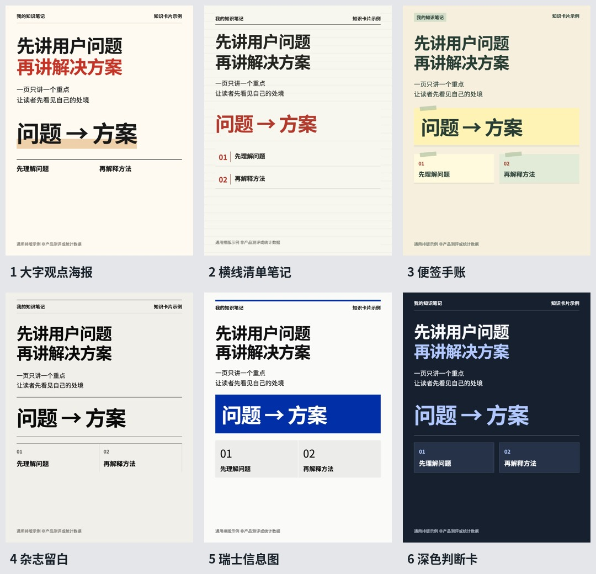

# 知识卡片工作室 · Knowledge Card Studio

**v1.3.1** · 给Agent一段文字，生成小红书图文；也可制作竖版口播视频。

支持WorkBuddy、Codex及其他具有本地文件和命令执行能力的Agent。通用仓库不含任何个人头像、录音、声音档案或账号配置。



## 给Agent这句话即可开始

> 请把 https://github.com/Keystone-shiqi/knowledge-card-studio 安装到我指定的本地目录。先读INSTALL.md和SKILL.md，检测本机环境，再打开首次初始化页面让我选择“图文或视频”和卡片风格。先使用小红书图文模式，不安装配音与语音识别模型。完成后用examples/notes.json自测，并报告实际图片路径。

完整步骤见[INSTALL.md](INSTALL.md)。不是所有Agent都支持通过URL自动注册Skill；WorkBuddy如需长期注册，可上传本仓库的`WorkBuddy入口Skill.zip`，再把程序根目录选为工作目录。

## 三种制作方式

| 输入 | 输出 | 运行依赖 |
|---|---|---|
| 一段文字 | 小红书PNG/JPG卡片组图、发布文案 | Python、Node、浏览器 |
| 已录配音＋图片 | 原声驱动竖版视频、字幕、封面 | 再加FFmpeg和本地Whisper |
| 文案＋本人声音档案 | 克隆配音竖版视频、封面 | 再加VoiceStudio/MOSS |

纯图文不要求VoiceStudio、Whisper、FFmpeg或头像；不经过视频渲染。图文编排由调用Skill的Agent完成，脚本负责确定性排版与导出，不包含独立的LLM写作服务。

## 1.3.1 新增

图文提供大字观点、横线清单、便签手账、杂志留白、瑞士信息图、深色判断卡六种精选。其中杂志与瑞士两种设计方向参考[归藏Skill](https://github.com/op7418/guizang-ppt-skill)中的杂志与瑞士体系，采用原创竖版CSS。这里的样张是设计参考，未经小红书实时互动数据验证；不承诺爆款。视频十种、旧图文十种预设及所有音频路线继续保留。详见[参考检索说明](references/图文参考检索.md)。

## 1.3 新增

- 图文直接导出1080×1440（3:4）PNG/JPG；可选1080×1920。
- 封面、对比、流程、数字、图片对照、结论六种图文版式，附可编辑HTML与来源说明。
- 原八种风格保留，新增产品分析浅色/深色，共十套；也能用于视频与自动封面。
- 首次在本机浏览器选择video/notes和视觉风格；默认无FIG和幕编号。品牌、栏目可自定义。
- 标题使用随包嵌入的思源黑体Bold700，正文与来源保留实际内容，不编造产品数据或证据图。

## 快速命令

```text
python scripts/portable.py init
python scripts/portable.py install --output-mode notes
python scripts/workflow.py notes --job examples/notes.json
```

Mac通常使用python3；Windows也可使用py -3。启动器为Mac_首次配置.command / Windows_首次配置.cmd；基础Python、Node需已安装。纯图文生成无需填写声音档案。

[图文输入说明](references/图文笔记.md) · [上传配音说明](references/上传配音.md) · [风格与页眉](references/风格与页眉.md)

## 视频与配音

保留静态头像、本地近似嘴型、现成口播视频、准备好的姿势图切换。嘴型只是近似动画，姿势图不是连续动作。上传原声不重新克隆、不自动变速。仅换视觉时可用restyle复用原声音与字幕。

文字克隆路线才会自动检测VoiceStudio，缺失时下载并校验官方v0.5.7安装包并打开。系统安装、MOSS模型准备及本人声音档案仍需首次完成；不会自动接受模型许可或回退云端。VoiceStudio是独立的[AGPLv3软件](https://github.com/debpalash/VoiceStudio/blob/v0.5.7/LICENSE)，本仓库不内嵌其安装包或模型。

## 验证范围

Mac M系列：已测试图文六页、十种风格、两种比例、图片版式、独立图文安装、上传原声及此前四个人物模式。新增视频风格做了HyperFrames检查与封面导出，未声称所有模式和所有长片都重新实测。Windows完整安装与WorkBuddy客户端实际导入仍待目标设备验证。

当前开发网络曾无法完整下载VoiceStudio官方安装包；下载校验逻辑已用本地HTTP测试，本机应用复用检测通过。音色、语气、近似嘴型自然度不能由ASR或自动布局检查替代。

## 发布与隐私

[安装包和源码下载](https://github.com/Keystone-shiqi/knowledge-card-studio/releases/tag/v1.3.1)。用户自己的profiles/input/avatars/jobs、运行时、模型权重及账号凭据不进入公开发布。

本项目自有代码与文档使用[MIT许可](LICENSE)；字体、GSAP与其他依赖保留各自许可，见[第三方资源说明.md](第三方资源说明.md)。
